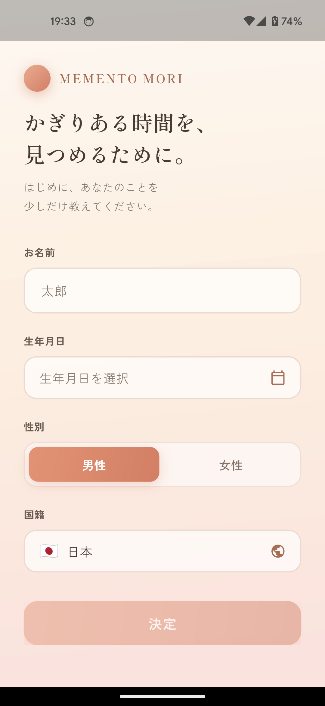
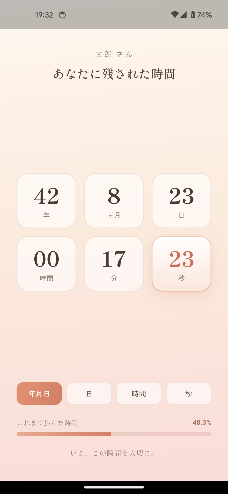
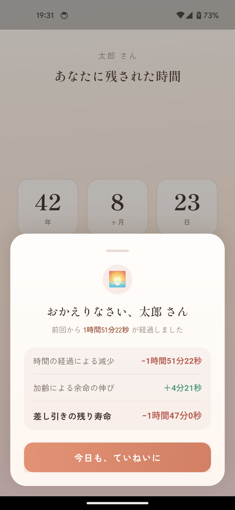

# 余命時計（メメント・モリ / Memento Mori）

「残り寿命」をリアルタイムにカウントダウン表示する Flutter アプリ。

平均「寿命」ではなく **平均余命（remaining life expectancy, e_x）** を使い、国・性別・年齢に
応じた残り時間を 年・月・日・時・分・秒 で刻みます。かぎりある時間を見つめ、いまを大切にするためのアプリです。

## 画面

<p align="center">
  
  &nbsp;&nbsp;
  
  &nbsp;&nbsp;
  
</p>

- **入力画面（左）** — 名前・生年月日・性別・国籍を入力（初回のみ）。生年月日は年/月/日の独立した
  3連ホイール、国籍は部分一致で検索できます。
- **カウントダウン（中央）** — 残り時間を 年月日時分秒 で表示。下部のセレクタで「日だけ」「時間だけ」
  「秒だけ」の総量表示にも切り替えられます。「これまで歩んだ時間」の割合も表示。
- **起動時の差分（右）** — 再訪時に、前回からの変化を秒単位で分解して知らせます。

## 入力項目
- 名前
- 生年月日（年/月/日のホイールで選択。月ごとの日数・閏年を自動調整）
- 性別（男/女）— 平均余命は性別で大きく異なるため
- **国籍（国）** — 国別に平均余命が異なるため。未収録国は世界平均にフォールバック

入力は初回のみ。`shared_preferences` で端末内に保存し、次回以降はカウントダウン画面から始まります。

## 余命の再計算と再訪時の差分
平均余命は加齢とともに伸びます（条件付き生存：20歳時点の「年齢＋余命」より50歳時点の方が長い）。
そのため死亡予測日時を1回で固定せず、**起動・バックグラウンド復帰・暦日変化のたびに再計算**します。
端数月齢は e(年齢) と e(年齢+1) を実日数比で線形補間し、秒単位の精度で死亡予測日時を求めます。

起動・復帰時、**前回開いてから60秒以上経過していれば**、前回からの差分を分解してシートで知らせます：

- **時間の経過による減少**（−経過分）
- **加齢による平均余命の伸び**（＋。予測死亡日が後ろ倒しになった量で常に正）
- **差し引きの残り寿命の変化**（上記2つの和、通常わずかに負）

差分は秒まで表示するので、短い再訪でも「減った分」と「伸びた分」の両方が見えます。

## 平均余命データ
- 出典：**UN World Population Prospects 2024**（国連人口部 / [PPgp/wpp2024](https://github.com/PPgp/wpp2024)）。
- 同梱の 1x1（各歳）死亡率 `mx`（2023年推計）から完全生命表を計算し、各国・男女別に各歳の e_x を算出。
  計算した e0 は WPP 公表値と一致することを検証済み（例：日本 男81.69 / 女87.74）。
- `assets/life_table.json` に **236の国・地域 ＋ 世界平均（`WORLD`）** を ISO 3166-1 alpha-2 コードで収録。
- 国名の日本語表示と国コードの突き合わせには `country_picker` パッケージを利用。

データの再生成手順は `tool/build_life_table.py` を参照。

## デザイン
- 暖色系（クリーム→ピーチ→ローズのグラデーション＋テラコッタのアクセント）。
- フォントは Google Fonts（見出し・数字に Shippori Mincho、UI に Zen Kaku Gothic New）。
- アプリ名は「余命時計」、アイコンは「夕陽が砂時計の地平に沈む」モチーフ。

## セットアップ
android/ios 等のプラットフォーム足場はリポジトリに含まれています。

```bash
flutter pub get
flutter analyze
flutter test
flutter run               # エミュレータ/実機で起動
```

## 主なファイル
- `lib/models/user_profile.dart` — 入力プロフィール（name/birthDate/gender/countryCode）
- `lib/services/life_expectancy.dart` — 生命表ロード・国選択／Worldフォールバック・補間・死亡日時算出・差分(`LifeDelta`)
- `lib/services/countdown_formatter.dart` — 残り時間の 年月日時分秒 への分解・符号付き差分の整形
- `lib/services/profile_store.dart` — プロフィールと前回スナップショットの保存/復元
- `lib/screens/input_screen.dart` — 入力画面（生年月日ホイール・国籍部分一致検索）
- `lib/screens/countdown_screen.dart` — カウントダウン画面（単位切替・差分シート）
- `lib/theme/app_theme.dart` — 色・グラデーション・テキストスタイルのトークン
- `test/life_expectancy_test.dart` — 補間・フォールバック・分解・整形の単体テスト
